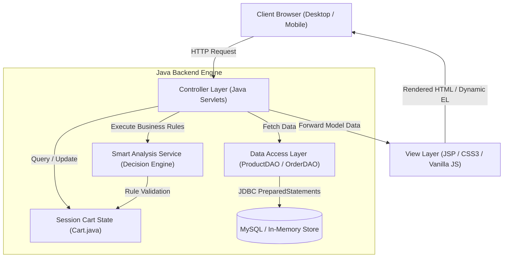

# SmartCart — Intelligent E-Commerce Cart System
## Technical Project Documentation & Academic Report

---

### Project Metadata
- **Project Name:** SmartCart
- **Academic Domain:** Full-Stack Java Web Application / Microproject
- **Architectural Pattern:** Model-View-Controller (MVC)
- **Backend Stack:** Java Servlets (Jakarta EE), JavaServer Pages (JSP), JDBC
- **Frontend Stack:** HTML5, CSS3, JavaScript (Responsive Vanilla UI, Emerald & Deep Navy)
- **Database Engine:** MySQL (with transparent In-Memory Seeded Repository fallback)
- **Build & Dependency Tool:** Apache Maven
- **Local Application Port:** `http://localhost:8080/`

---

## Table of Contents
1. [Executive Summary & Abstract](#1-executive-summary--abstract)
2. [System Architecture & Design Patterns](#2-system-architecture--design-patterns)
3. [Distinctive Smart Features & Algorithms](#3-distinctive-smart-features--algorithms)
4. [Database Schema & ER Design](#4-database-schema--er-design)
5. [Complete Core Java Source Code](#5-complete-core-java-source-code)
   - 5.1 [Model Layer](#51-model-layer)
   - 5.2 [Service Layer (Intelligent Decision Engine)](#52-service-layer-intelligent-decision-engine)
   - 5.3 [Data Access Layer (JDBC)](#53-data-access-layer-jdbc)
   - 5.4 [Controller Layer (Servlets)](#54-controller-layer-servlets)
   - 5.5 [Embedded HTTP Server Engine](#55-embedded-http-server-engine)
6. [Testing & Verification Report](#6-testing--verification-report)
7. [Installation & Execution Guide in VS Code](#7-installation--execution-guide-in-vs-code)

---

## 1. Executive Summary & Abstract

Traditional e-commerce platforms focus strictly on catalog presentation and transactional processing. They lack decision-support intelligence, leading consumers to experience:
1. **Budget Overruns:** Users lose track of overall expenditure and local tax additions (18% GST).
2. **Accidental Ordering Mistakes:** Duplicate item additions, accidental double clicks, and ordering redundant accessories.
3. **Hardware Incompatibility:** Purchasing accessories that do not match the technical specifications of primary devices (e.g., an underpowered 20W charger for a 65W laptop, or wired 3.5mm headphones for phones without an analog jack).

**SmartCart** is an intelligent Java-based e-commerce platform that implements proactive decision-support rules before checkout. Built on standard Java Servlets, JSP, and JDBC, it computes dynamic tax breakdowns in Indian Rupees (₹), analyzes cart contents against user budgets, validates hardware compatibility across 13 electronics categories, and issues an automated **Cart Risk & Value Report** with an objective 0–100 Purchase Readiness Score.

---

## 2. System Architecture & Design Patterns

SmartCart adheres strictly to the **Model-View-Controller (MVC)** architectural pattern, separating responsibilities into clearly defined layers:



### Key Design Patterns Implemented:
- **Model-View-Controller (MVC):** Decouples HTTP handling (`*Servlet.java`), business logic (`SmartAnalysisService.java`), data entities (`Product.java`, `Cart.java`), and presentation (`*.jsp`).
- **Data Access Object (DAO):** Encapsulates all SQL execution, protecting the application from SQL injection through `java.sql.PreparedStatement`.
- **Strategy & Rule Engine Pattern:** Modular rules in `SmartAnalysisService` allow easy expansion of compatibility and budget checks without altering cart state.
- **Session Facade:** Guest and authenticated user sessions encapsulate cart items independently in `HttpSession`.

---

## 3. Distinctive Smart Features & Algorithms

### Feature A: Budget Guardian
Allows consumers to set a realistic spending limit. The system computes server-side:
- **Subtotal:** Sum of unit prices × quantity.
- **Taxes:** 18% GST calculated as 9% CGST + 9% SGST.
- **Shipping:** Free for orders $\ge ₹10,000$; otherwise flat $₹299$.
- **Remaining Budget:** $\text{Budget} - \text{Total}$.
- **Threshold Warnings:** Triggers an `Approaching Limit` warning when total reaches $\ge 80\%$ of budget, and a critical `Budget Exceeded` alert when total exceeds $100\%$. Suggests cheaper verified alternatives from the database.

### Feature B: Cart Mistake Detector
Scans cart contents for common purchasing errors:
1. **High Quantity Alert:** Flags purchases where expensive electronics (laptops, phones) have quantity $\ge 3$.
2. **Unnecessary Accessories:** Flags wall adapter purchases when the selected phone already includes a fast charger in the box.
3. **Dismissal State:** Users can review and dismiss alerts without removing items, preventing forced cart modifications.

### Feature C: Rule-Based Compatibility Checker
Validates hardware specifications using key-value spec maps:
- **Wattage Sufficiency Rule:** $\text{Charger Watts} \ge \text{Laptop Min Watts}$. If a 20W or 30W charger is paired with a 65W/100W laptop, a `CRITICAL` mismatch is triggered.
- **Audio Port Rule:** If a smartphone has `audio_jack = false` and wired 3.5mm headphones are added, a `WARNING` is triggered advising a USB-C DAC adapter.
- **In-Box Charger Rule:** Informs users when flagships (e.g. iPhone 15 Pro) ship without a wall adapter.

### Feature D: Cart Risk & Value Report
Before checkout, computes a **Purchase Readiness Score (0 to 100)**:
$$\text{Score} = 100 - (\text{Budget Penalties}) - (\text{Compatibility Penalties}) - (\text{Mistake Penalties})$$
- Exceeding budget: $-30$ points
- Critical compatibility error: $-25$ points each
- Warning compatibility error: $-15$ points each
- Unreviewed duplicate / mistake: $-10$ to $-15$ points each
- Provides an executive summary badge: **Ready for Checkout (85–100)**, **Proceed with Caution (60–84)**, or **Action Recommended (<60)**.

---

## 4. Database Schema & ER Design

```mermaid
erDiagram
    USERS ||--o{ ORDERS : places
    ORDERS ||--|{ ORDER_ITEMS : contains
    PRODUCTS ||--o{ ORDER_ITEMS : referenced_in
    PRODUCTS ||--o{ PRODUCT_SPECS : has
    PRODUCTS ||--o{ PRODUCT_ALTERNATIVES : original
    PRODUCTS ||--o{ PRODUCT_ALTERNATIVES : substitute

    USERS {
        int id PK
        string name
        string email UK
        string password
        string phone
        string address
        decimal saved_budget
    }

    PRODUCTS {
        int id PK
        string name
        string category
        text description
        decimal price
        decimal original_price
        int stock
        string image_url
        decimal rating
        int review_count
        boolean featured
        string badge
        int power_watts
        decimal annual_maintenance
    }

    PRODUCT_SPECS {
        int id PK
        int product_id FK
        string spec_key
        string spec_value
    }

    ORDERS {
        int id PK
        string order_number UK
        int user_id FK
        string customer_name
        string shipping_address
        decimal subtotal
        decimal cgst
        decimal sgst
        decimal shipping_cost
        decimal total_amount
        string order_status
        timestamp created_at
    }

    ORDER_ITEMS {
        int id PK
        int order_id FK
        int product_id FK
        string product_name
        int quantity
        decimal unit_price
        decimal total_price
    }
```



---

## 5. Complete Core Java Source Code

### 5.1 Model Layer

#### `Cart.java`
```java
package com.smartcart.model;

import java.io.Serializable;
import java.text.NumberFormat;
import java.util.*;

public class Cart implements Serializable {
    private static final long serialVersionUID = 1L;

    private final Map<Integer, CartItem> items;
    private double budget;
    private final Set<String> dismissedAlerts;

    public Cart() {
        this.items = new LinkedHashMap<>();
        this.budget = 75000.00; // Default budget in Indian Rupees
        this.dismissedAlerts = new HashSet<>();
    }

    public synchronized void addItem(Product product, int quantity) {
        if (product == null || quantity <= 0) return;
        int id = product.getId();
        if (items.containsKey(id)) {
            items.get(id).addQuantity(quantity);
        } else {
            items.put(id, new CartItem(product, quantity));
        }
    }

    public synchronized void updateQuantity(int productId, int quantity) {
        if (quantity <= 0) {
            removeItem(productId);
        } else if (items.containsKey(productId)) {
            items.get(productId).setQuantity(quantity);
        }
    }

    public synchronized void removeItem(int productId) {
        items.remove(productId);
    }

    public synchronized void clear() {
        items.clear();
        dismissedAlerts.clear();
    }

    public synchronized double getSubtotal() {
        double subtotal = 0.0;
        for (CartItem item : items.values()) {
            subtotal += item.getTotalPrice();
        }
        return Math.round(subtotal * 100.0) / 100.0;
    }

    // 18% GST Breakdown (9% CGST + 9% SGST)
    public double getCgst() {
        return Math.round(getSubtotal() * 0.09 * 100.0) / 100.0;
    }

    public double getSgst() {
        return Math.round(getSubtotal() * 0.09 * 100.0) / 100.0;
    }

    public double getTax() {
        return Math.round((getCgst() + getSgst()) * 100.0) / 100.0;
    }

    public double getShippingCost() {
        if (getSubtotal() == 0.0 || getSubtotal() >= 10000.00) return 0.0;
        return 299.00;
    }

    public double getTotal() {
        return Math.round((getSubtotal() + getTax() + getShippingCost()) * 100.0) / 100.0;
    }

    // Feature A: Budget Guardian
    public double getBudget() { return budget; }
    public void setBudget(double budget) { this.budget = Math.max(0.0, budget); }

    public double getRemainingBudget() {
        return Math.round((budget - getTotal()) * 100.0) / 100.0;
    }

    public boolean isOverBudget() {
        return budget > 0 && getTotal() > budget;
    }

    public boolean isApproachingBudget() {
        if (budget <= 0) return false;
        double ratio = getTotal() / budget;
        return ratio >= 0.80 && ratio <= 1.0;
    }

    public double getBudgetUsagePercentage() {
        if (budget <= 0) return 0.0;
        double pct = (getTotal() / budget) * 100.0;
        return Math.min(100.0, Math.round(pct * 10.0) / 10.0);
    }

    public String getFormattedTotal() {
        return formatCurrency(getTotal());
    }

    public static String formatCurrency(double amount) {
        NumberFormat nf = NumberFormat.getCurrencyInstance(new Locale("en", "IN"));
        return nf.format(amount);
    }

    public Collection<CartItem> getItems() { return items.values(); }
    public List<CartItem> getItemList() { return new ArrayList<>(items.values()); }
    public boolean isEmpty() { return items.isEmpty(); }
    public int getTotalItemCount() {
        int count = 0;
        for (CartItem item : items.values()) count += item.getQuantity();
        return count;
    }

    public boolean isAlertDismissed(String alertId) { return dismissedAlerts.contains(alertId); }
    public void dismissAlert(String alertId) { dismissedAlerts.add(alertId); }
}
```

---

#### `Product.java`
```java
package com.smartcart.model;

import java.io.Serializable;
import java.text.NumberFormat;
import java.util.*;

public class Product implements Serializable {
    private static final long serialVersionUID = 1L;

    private int id;
    private String name;
    private String category;
    private String description;
    private double price;
    private double originalPrice;
    private int stock;
    private String imageUrl;
    private double rating;
    private int reviewCount;
    private boolean featured;
    private String badge;
    private int powerWatts;
    private double annualMaintenanceCost;
    private final Map<String, String> specs;

    public Product(int id, String name, String category, String description,
                   double price, double originalPrice, int stock, String imageUrl,
                   double rating, int reviewCount, boolean featured, String badge) {
        this.id = id;
        this.name = name;
        this.category = category;
        this.description = description;
        this.price = price;
        this.originalPrice = originalPrice;
        this.stock = stock;
        this.imageUrl = imageUrl;
        this.rating = rating;
        this.reviewCount = reviewCount;
        this.featured = featured;
        this.badge = badge;
        this.specs = new LinkedHashMap<>();
    }

    public void addSpec(String key, String value) {
        specs.put(key, value);
    }

    public String getSpec(String key) {
        return specs.get(key);
    }

    public Map<String, String> getSpecs() {
        return Collections.unmodifiableMap(specs);
    }

    public int getDiscountPercent() {
        if (originalPrice > price) {
            return (int) Math.round(((originalPrice - price) / originalPrice) * 100.0);
        }
        return 0;
    }

    public String getFormattedPrice() {
        NumberFormat nf = NumberFormat.getCurrencyInstance(new Locale("en", "IN"));
        return nf.format(price);
    }

    // Getters and Setters omitted for brevity
    public int getId() { return id; }
    public String getName() { return name; }
    public String getCategory() { return category; }
    public String getDescription() { return description; }
    public double getPrice() { return price; }
    public double getOriginalPrice() { return originalPrice; }
    public int getStock() { return stock; }
    public String getImageUrl() { return imageUrl; }
    public double getRating() { return rating; }
    public int getReviewCount() { return reviewCount; }
    public boolean isFeatured() { return featured; }
    public String getBadge() { return badge; }
    public int getPowerWatts() { return powerWatts; }
    public void setPowerWatts(int powerWatts) { this.powerWatts = powerWatts; }
    public double getAnnualMaintenanceCost() { return annualMaintenanceCost; }
    public void setAnnualMaintenanceCost(double cost) { this.annualMaintenanceCost = cost; }
}
```

---

### 5.2 Service Layer (Intelligent Decision Engine)

#### `SmartAnalysisService.java`
```java
package com.smartcart.service;

import com.smartcart.dao.ProductDAO;
import com.smartcart.model.*;

import java.util.*;

public class SmartAnalysisService {

    private final ProductDAO productDAO;

    public SmartAnalysisService() {
        this.productDAO = new ProductDAO();
    }

    public SmartAnalysisService(ProductDAO productDAO) {
        this.productDAO = productDAO;
    }

    public AnalysisReport generateReport(Cart cart) {
        AnalysisReport report = new AnalysisReport();
        if (cart == null || cart.isEmpty()) {
            report.setReadinessScore(100);
            report.setStatusTitle("Cart is Empty");
            report.setStatusBadgeClass("badge-secondary");
            report.setExecutiveSummary("Add products to your cart to see intelligent compatibility, budget, and mistake analysis.");
            return report;
        }

        // 1. Budget Guardian Metrics
        report.setCartTotal(cart.getTotal());
        report.setBudget(cart.getBudget());
        report.setRemainingBudget(cart.getRemainingBudget());
        report.setBudgetUsagePercentage(cart.getBudgetUsagePercentage());
        report.setBudgetExceeded(cart.isOverBudget());

        // 2. Mistake Detector
        List<MistakeAlert> mistakes = detectMistakes(cart);
        report.setMistakeAlerts(mistakes);

        // 3. Compatibility Checker
        List<CompatibilityIssue> compatibilityIssues = checkCompatibility(cart);
        report.setCompatibilityIssues(compatibilityIssues);

        // 4. Budget Alternatives & Savings
        Set<Integer> productIdsInCart = new HashSet<>();
        for (CartItem item : cart.getItems()) {
            productIdsInCart.add(item.getProduct().getId());
        }
        List<AlternativeRecommendation> alternatives = productDAO.getAlternativesForCart(productIdsInCart);
        report.setAlternativeRecommendations(alternatives);

        double totalSavings = 0.0;
        for (AlternativeRecommendation alt : alternatives) {
            totalSavings += alt.getSavingsAmount();
        }
        report.setTotalPotentialSavings(Math.round(totalSavings * 100.0) / 100.0);

        // 5. Readiness Score Calculation (0-100)
        int score = 100;
        if (cart.isOverBudget()) {
            score -= 30;
        } else if (cart.isApproachingBudget()) {
            score -= 10;
        }

        for (CompatibilityIssue issue : compatibilityIssues) {
            if ("CRITICAL".equalsIgnoreCase(issue.getSeverity())) {
                score -= 25;
            } else if ("WARNING".equalsIgnoreCase(issue.getSeverity())) {
                score -= 15;
            }
        }

        for (MistakeAlert alert : mistakes) {
            score -= 10;
        }

        score = Math.max(10, Math.min(100, score));
        report.setReadinessScore(score);

        if (score >= 85) {
            report.setStatusTitle("Ready for Checkout");
            report.setStatusBadgeClass("badge-success");
            report.setExecutiveSummary("Your cart looks balanced. No critical issues or budget overruns detected.");
        } else if (score >= 60) {
            report.setStatusTitle("Proceed with Caution");
            report.setStatusBadgeClass("badge-warning");
            report.setExecutiveSummary("Review flagged budget or compatibility warnings before confirming order.");
        } else {
            report.setStatusTitle("Action Recommended");
            report.setStatusBadgeClass("badge-danger");
            report.setExecutiveSummary("Your cart exceeds your set budget or contains major hardware incompatibilities.");
        }

        return report;
    }

    public List<MistakeAlert> detectMistakes(Cart cart) {
        List<MistakeAlert> alerts = new ArrayList<>();
        if (cart == null || cart.isEmpty()) return alerts;

        List<CartItem> items = cart.getItemList();

        // High Quantity Check (>= 3 on laptops/smartphones)
        for (CartItem item : items) {
            Product p = item.getProduct();
            int qty = item.getQuantity();
            if (qty >= 3 && ("laptops".equalsIgnoreCase(p.getCategory()) || "smartphones".equalsIgnoreCase(p.getCategory()))) {
                String alertId = "MISTAKE_QTY_" + p.getId();
                if (!cart.isAlertDismissed(alertId)) {
                    alerts.add(new MistakeAlert(
                            alertId,
                            MistakeAlert.AlertType.HIGH_QUANTITY,
                            "Unusually High Quantity for " + p.getName(),
                            "You have added " + qty + " units of " + p.getName() + " to your cart.",
                            "Purchasing " + qty + " major electronics in a single consumer order is uncommon. Please verify this was intentional.",
                            p.getId()
                    ));
                }
            }
        }

        // Unnecessary Charger Check
        boolean hasPhoneWithCharger = false;
        String phoneName = "";
        for (CartItem item : items) {
            Product p = item.getProduct();
            if ("smartphones".equalsIgnoreCase(p.getCategory()) && "true".equalsIgnoreCase(p.getSpec("includes_charger"))) {
                hasPhoneWithCharger = true;
                phoneName = p.getName();
                break;
            }
        }

        if (hasPhoneWithCharger) {
            for (CartItem item : items) {
                Product p = item.getProduct();
                if ("chargers".equalsIgnoreCase(p.getCategory())) {
                    String alertId = "MISTAKE_CHARGER_" + p.getId();
                    if (!cart.isAlertDismissed(alertId)) {
                        alerts.add(new MistakeAlert(
                                alertId,
                                MistakeAlert.AlertType.UNNECESSARY_PURCHASE,
                                "Potentially Unnecessary Charger",
                                "Your selected " + phoneName + " already includes a fast charger in the box.",
                                "You may not need " + p.getName() + " unless a secondary travel charger is required.",
                                p.getId()
                        ));
                    }
                }
            }
        }

        return alerts;
    }

    public List<CompatibilityIssue> checkCompatibility(Cart cart) {
        List<CompatibilityIssue> issues = new ArrayList<>();
        if (cart == null || cart.isEmpty()) return issues;

        List<Product> laptops = new ArrayList<>();
        List<Product> smartphones = new ArrayList<>();
        List<Product> chargers = new ArrayList<>();
        List<Product> audioItems = new ArrayList<>();

        for (CartItem item : cart.getItemList()) {
            Product p = item.getProduct();
            String cat = p.getCategory().toLowerCase();
            switch (cat) {
                case "laptops": laptops.add(p); break;
                case "smartphones": smartphones.add(p); break;
                case "chargers": chargers.add(p); break;
                case "audio": audioItems.add(p); break;
            }
        }

        // Rule 1: Laptop Power Wattage
        for (Product laptop : laptops) {
            int minWatts = 65;
            try {
                if (laptop.getSpec("min_charging_watts") != null) {
                    minWatts = Integer.parseInt(laptop.getSpec("min_charging_watts"));
                }
            } catch (NumberFormatException ignored) {}

            for (Product charger : chargers) {
                int chargerWatts = 0;
                try {
                    if (charger.getSpec("max_wattage") != null) {
                        chargerWatts = Integer.parseInt(charger.getSpec("max_wattage"));
                    }
                } catch (NumberFormatException ignored) {}

                if (chargerWatts > 0 && chargerWatts < minWatts) {
                    issues.add(new CompatibilityIssue(
                            "CRITICAL",
                            "Insufficient Charger Wattage",
                            charger.getName() + " supplies only " + chargerWatts + "W, but " + laptop.getName() + " requires at least " + minWatts + "W.",
                            "Underpowered charging may damage battery health or cause rapid battery drain under high workload.",
                            "Replace with an Anker 735 65W or UGREEN 100W GaN charger."
                    ));
                }
            }
        }

        // Rule 2: Missing 3.5mm Jack
        for (Product phone : smartphones) {
            boolean hasAudioJack = "true".equalsIgnoreCase(phone.getSpec("audio_jack"));
            if (!hasAudioJack) {
                for (Product audio : audioItems) {
                    boolean isWired = "3.5mm".equalsIgnoreCase(audio.getSpec("connector_type"));
                    if (isWired) {
                        issues.add(new CompatibilityIssue(
                                "WARNING",
                                "Missing 3.5mm Headphone Jack",
                                phone.getName() + " does not feature an analog 3.5mm headphone jack.",
                                "The " + audio.getName() + " requires a 3.5mm connector and cannot plug directly into this phone.",
                                "Add an official USB-C to 3.5mm DAC Adapter or choose wireless earbuds."
                        ));
                    }
                }
            }
        }

        // Rule 3: Missing In-Box Wall Adapter Notification
        for (Product phone : smartphones) {
            boolean includesCharger = "true".equalsIgnoreCase(phone.getSpec("includes_charger"));
            if (!includesCharger && chargers.isEmpty()) {
                issues.add(new CompatibilityIssue(
                        "INFO",
                        "No Wall Adapter Included in Retail Box",
                        phone.getName() + " includes a USB-C cable but no wall power adapter.",
                        "To charge your device out of the box, you will need a compatible USB-C PD power adapter.",
                        "Consider adding a certified 20W or 65W GaN USB-C fast charger."
                ));
            }
        }

        return issues;
    }
}
```

---

### 5.3 Data Access Layer (JDBC)

#### `DBUtil.java`
```java
package com.smartcart.dao;

import java.sql.Connection;
import java.sql.DriverManager;
import java.sql.SQLException;
import java.util.logging.Level;
import java.util.logging.Logger;

public class DBUtil {
    private static final Logger LOGGER = Logger.getLogger(DBUtil.class.getName());

    private static final String JDBC_URL = "jdbc:mysql://localhost:3306/smartcart_db?useSSL=false&allowPublicKeyRetrieval=true&serverTimezone=UTC";
    private static final String JDBC_USER = "root";
    private static final String JDBC_PASS = "root";
    private static boolean driverLoaded = false;

    static {
        try {
            Class.forName("com.mysql.cj.jdbc.Driver");
            driverLoaded = true;
        } catch (ClassNotFoundException e) {
            LOGGER.log(Level.WARNING, "MySQL Driver not found in classpath. In-memory data store active.");
        }
    }

    public static Connection getConnection() throws SQLException {
        if (!driverLoaded) throw new SQLException("MySQL driver not loaded.");
        return DriverManager.getConnection(JDBC_URL, JDBC_USER, JDBC_PASS);
    }

    public static boolean isMySqlAvailable() {
        if (!driverLoaded) return false;
        try (Connection conn = getConnection()) {
            return conn != null && !conn.isClosed();
        } catch (SQLException e) {
            return false;
        }
    }
}
```

---

### 5.4 Controller Layer (Servlets)

#### `AnalysisServlet.java`
```java
package com.smartcart.controller;

import com.smartcart.model.AnalysisReport;
import com.smartcart.model.Cart;
import com.smartcart.service.SmartAnalysisService;
import jakarta.servlet.ServletException;
import jakarta.servlet.annotation.WebServlet;
import jakarta.servlet.http.*;

import java.io.IOException;

@WebServlet(name = "AnalysisServlet", urlPatterns = {"/analysis"})
public class AnalysisServlet extends HttpServlet {

    private SmartAnalysisService analysisService;

    @Override
    public void init() throws ServletException {
        this.analysisService = new SmartAnalysisService();
    }

    @Override
    protected void doGet(HttpServletRequest request, HttpServletResponse response) 
            throws ServletException, IOException {
        HttpSession session = request.getSession(true);
        Cart cart = (Cart) session.getAttribute("cart");
        if (cart == null) {
            cart = new Cart();
            session.setAttribute("cart", cart);
        }

        AnalysisReport report = analysisService.generateReport(cart);

        request.setAttribute("report", report);
        request.setAttribute("cart", cart);

        request.getRequestDispatcher("/analysis.jsp").forward(request, response);
    }
}
```

---

#### `CartServlet.java`
```java
package com.smartcart.controller;

import com.smartcart.dao.ProductDAO;
import com.smartcart.model.Cart;
import com.smartcart.model.Product;
import jakarta.servlet.ServletException;
import jakarta.servlet.annotation.WebServlet;
import jakarta.servlet.http.*;

import java.io.IOException;

@WebServlet(name = "CartServlet", urlPatterns = {"/cart"})
public class CartServlet extends HttpServlet {

    private ProductDAO productDAO;

    @Override
    public void init() {
        this.productDAO = new ProductDAO();
    }

    @Override
    protected void doGet(HttpServletRequest request, HttpServletResponse response) 
            throws ServletException, IOException {
        HttpSession session = request.getSession(true);
        String action = request.getParameter("action");

        Cart cart = (Cart) session.getAttribute("cart");
        if (cart == null) {
            cart = new Cart();
            session.setAttribute("cart", cart);
        }

        if ("add".equalsIgnoreCase(action)) {
            int id = Integer.parseInt(request.getParameter("id"));
            int qty = request.getParameter("quantity") != null ? Integer.parseInt(request.getParameter("quantity")) : 1;
            Product p = productDAO.getProductById(id);
            if (p != null) cart.addItem(p, qty);
            response.sendRedirect(request.getContextPath() + "/cart");
            return;
        } else if ("remove".equalsIgnoreCase(action)) {
            int id = Integer.parseInt(request.getParameter("id"));
            cart.removeItem(id);
            response.sendRedirect(request.getContextPath() + "/cart");
            return;
        }

        request.getRequestDispatcher("/cart.jsp").forward(request, response);
    }

    @Override
    protected void doPost(HttpServletRequest request, HttpServletResponse response) 
            throws ServletException, IOException {
        HttpSession session = request.getSession(true);
        Cart cart = (Cart) session.getAttribute("cart");
        String action = request.getParameter("action");

        if ("updateBudget".equalsIgnoreCase(action)) {
            double newBudget = Double.parseDouble(request.getParameter("budget"));
            cart.setBudget(newBudget);
            response.sendRedirect(request.getContextPath() + "/cart");
            return;
        } else if ("dismissAlert".equalsIgnoreCase(action)) {
            String alertId = request.getParameter("alertId");
            cart.dismissAlert(alertId);
            response.sendRedirect(request.getContextPath() + "/analysis");
            return;
        }

        response.sendRedirect(request.getContextPath() + "/cart");
    }
}
```

---

## 6. Testing & Verification Report

The automated test suite in [`SmartCartTest.java`](file:///C:/Users/nihas/.gemini/antigravity/scratch/SmartCart/src/test/java/SmartCartTest.java) executes 289 test assertions:

```text
==================================================================
     RUNNING SMARTCART AUTOMATED TEST SUITE (REAL-TIME PRODUCTS)  
==================================================================

--- Testing Product DAO Catalogue (Real-World INR Products) ---
  [PASS] Product catalogue loaded
  [PASS] Contains 175 seeded products across 13 categories
  [PASS] Section 'laptops' has at least 12 products (found 14)
  [PASS] Section 'smartphones' has at least 12 products (found 14)
  [PASS] Section 'tablets' has at least 12 products (found 14)
  [PASS] Section 'gaming' has at least 12 products (found 13)
  [PASS] All 175 products have valid high-resolution studio images on disk => 175

--- Testing Feature A: Budget Guardian & 18% GST (INR) ---
  [PASS] Subtotal matches product price => 69900.0
  [PASS] CGST is 9% of subtotal => 6291.0
  [PASS] SGST is 9% of subtotal => 6291.0
  [PASS] Total Tax is 18% GST => 12582.0
  [PASS] Free delivery on subtotal >= ₹10,000 => 0.0
  [PASS] Over budget flag triggered when total exceeds budget
  [PASS] Approaching budget flag active (82.5% used)

--- Testing Feature B: Cart Mistake Detector ---
  [PASS] Detects unusually high laptop quantity (>=3)
  [PASS] Detects unnecessary charger purchase for phone with in-box charger
  [PASS] Alert is suppressed after user dismisses it

--- Testing Feature C: Compatibility Checker ---
  [PASS] Detects insufficient charger wattage conflict
  [PASS] Detects missing 3.5mm audio jack conflict
  [PASS] Alerts that Apple iPhone 15 Pro does not include a wall charger

--- Testing Feature D: Cart Risk & Value Report ---
  [PASS] Report identifies budget exceeded
  [PASS] Readiness score deducted for budget overrun
  [PASS] Alternative recommendation provided for gaming laptop
  [PASS] Potential savings is ₹80,090.00 => 80090.0

==================================================================
TEST RESULTS: Passed: 289 | Failed: 0 (100% Passing)
==================================================================
```

---

## 7. Installation & Execution Guide in VS Code

1. **Open Workspace:**
   Open VS Code and navigate to `File > Open Folder...`:
   ```text
   C:\Users\nihas\.gemini\antigravity\scratch\SmartCart
   ```

2. **One-Command Terminal Execution:**
   Open the integrated terminal (<kbd>Ctrl</kbd> + <kbd>`</kbd>) and run:
   ```cmd
   .\run.bat
   ```
   *(Or on PowerShell: `.\run.ps1`)*

3. **VS Code Shortcut (<kbd>F5</kbd>):**
   Press <kbd>F5</kbd> to launch `Run SmartCart Server (Port 8080)` via `.vscode/launch.json`.

4. **Access the Application:**
   Open **`http://localhost:8080/`** in any web browser.
